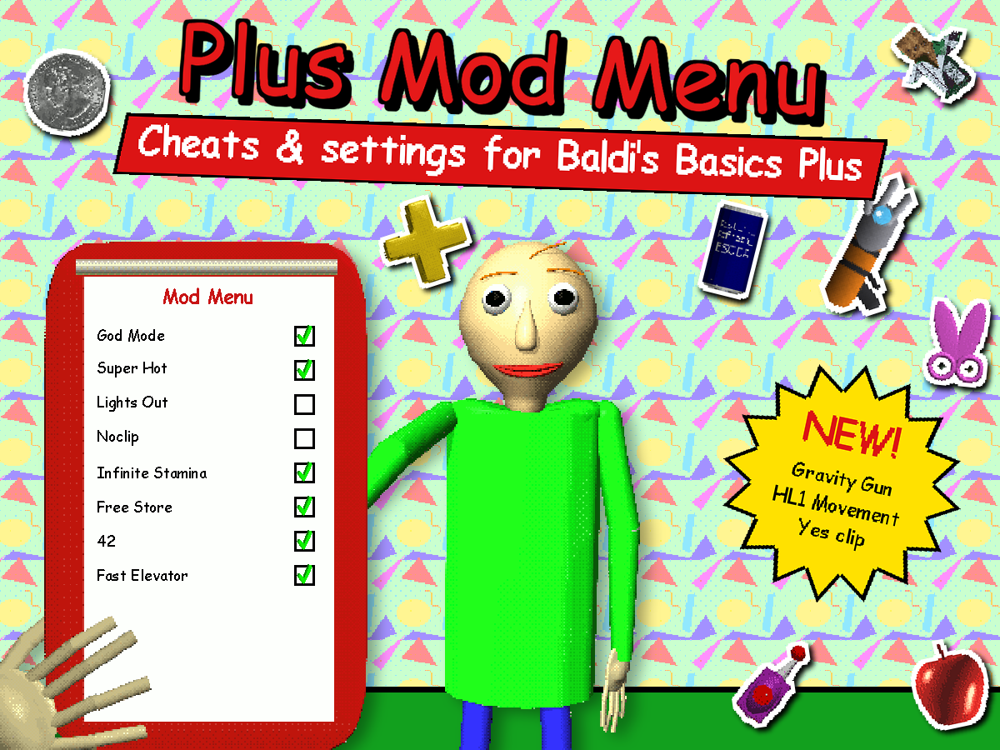

# Plus Mod Menu



Меню модификаций для Baldi's Basics Plus 0.14.5 от Kanoyo. Персонажи, предметы, события, игрок, сцены, телепорт и модификаторы Classic, Yet Again на одном планшете в стиле экрана настроек игры.

## Установка

1. Установите BepInEx 5 в папку игры.
2. Положите `PlusModMenu.dll` из архива в `BepInEx/plugins`, прямо туда или в любую подпапку. Весь мод — этот один файл, других библиотек не нужно.
3. Запустите игру и нажмите **Tab**, чтобы открыть меню.

## Русский язык

Меню переходит на русский, если установлен CyrillicPlus: он добавляет кириллицу в шрифты игры. Язык можно выбрать и вручную в настройках меню.

## HL1 Movement

**Игрок → Движение → HL1 Movement** переключает игрока на движение из Half-Life 1 (WON-версия: без ограничения скорости при баннихопе, если держать прыжок, игрок прыгает снова при приземлении).

- **Левая кнопка мыши:** прыжок (если держать — баннихоп). Нажатие на предметы работает как обычно. На E прыжка нет.
- **Левый Ctrl:** присед. **E:** взять предмет или небольшую мебель (стул, столик, парту) и поставить обратно. Все три клавиши меняются рядом с переключателем; клавиша прыжка есть и рядом с «Прыжком везде», он прыгает на неё же.
- Бег и выносливость отключены; стаминометр становится спидометром в единицах HL (320 — обычный бег).
- На **E** переносится и декор без коллизий: глобусы, горшки с цветами, бумаги, подносы с обедом.
- **Yes clip:** зажмите проп между собой и стеной (держите его в руках или упритесь в стоящий у стены) и давите вперёд, прыгая. Через прыжок-два проп протолкнёт игрока сквозь стену в комнату за ней.
- **Пропы:** отпущенный предмет падает, скользит и ложится на то, что под ним; большая мебель, которой не хватает места, выталкивается из стены, а не застревает в руках. Что стояло на поднятой мебели, падает, включая предметы, монетки и блокноты. Проп, вдавленный или брошенный в окно, разбивает его. NPC обходят переставленную мебель, как стену.
- Пока режим включён, камера разблокирована; при выключении HL1 Movement возвращаются прежние настройки камеры, прыжков и скорости.

## Читы и инструменты

- **Игрок → Выживание:** God Mode (не ловят ни Baldi, ни смертельное касание из Classic, Yet Again), YTP, жизни и оценка.
- **Предметы → Общее:** предметы где угодно (в Pitstop и магазине Джонни, за пределами карты), Gravity Gun, который может лежать на этаже среди других предметов, и кнопка, чтобы его выдать. Gravity Gun поднимает любую мебель, включая шкафчики и столы (но не задачи, блокноты, двери и лифты); повторное использование бросает то, что он держит, клавиша «Взять» (E) ставит предмет, а щелчок колесом мыши включает вращение: мышь крутит предмет в руках вместо камеры до следующего щелчка, а двойной щелчок выравнивает его (ставит ровно, с поворотом на четверть). Брошенная мебель отталкивает NPC. Из инвентаря он не пропадает.
- **Прочее → Мир → Магазин Джонни:** бесплатный магазин, скидка 100% на всё.
- **Прочее → Мир → Экскурсии:** автовин мини-игр: мини-игра экскурсии засчитывается идеальной победой сразу после заставки.
- **Прочее → Мир:** решить все задачи (математические машины, шарики подсчёта, Match — как будто игрок решил их правильно), открыть всю карту, стрелки NPC на карте в цвет персонажа, открыть, запереть или отпереть все двери, разбить все окна, открыть запертые комнаты, открыть все выходы, закончить этаж.
- **Сцены → Сид:** текущий сид и фиксированный сид для этажей из менеджера сцен.
- **Персонажи:** Dr. Reflex и The Test.
- **События:** Карантин, Таинственная комната, Время вышло, BalderDash и Толпа учеников, с настройками.
- **Прочее → Стикеры:** стикер в каждом из четырёх слотов, клей на каждом слоте, добавление стикеров в альбом.
- **42** (Прочее) теперь действует на все шарики: на шариках математических машин везде 42, шарики подсчёта считаются до 42 из 42, а пары в Match — пары из 42.
- **Телепорт → Блокноты** работает и со второго этажа: если блокнот ещё в задаче, задача сначала решается.
- **Телепорт → Классы:** кнопка для каждого класса этажа.
- **Прочее → Мир → Лифт:** быстрый лифт: лифт между этажами (приближение, двери, доска результатов, ожидание) идёт в восемь раз быстрее.
- **Предметы → Редактор слотов** предлагает и потерянные игрушки учеников.
- **Режим отладки** (Прочее → Данные игрока, по умолчанию выключен) показывает панель отладки: сид, клетку под игроком, план событий этажа, гнев Baldi.

## Бинды

Правый клик по любому переключателю, кнопке или выбору в меню, затем нажмите клавишу: в игре она переключит переключатель, нажмёт кнопку или переключит на следующий вариант. Клавиша видна серым после названия. Правый клик ещё раз — сменить, Esc во время ожидания — сбросить бинд. Пока меню открыто, бинды не срабатывают. Уведомление вверху экрана показывает, что сделала клавиша, например «God Mode: вкл».

## Сохранить функцию навсегда

Alt+клик по переключателю оставляет его включённым после перезапуска игры: он включается, название становится зелёным, и при каждом запуске функция включается снова. Alt+клик ещё раз убирает сохранение (сама функция остаётся как есть).

## Примечания

- Сохранения с модом идут в отдельный профиль с суффиксом `__ModMenu`, рекорды не записываются.
- Настройки меню (клавиша открытия, язык, клавиши прыжка, бинды, сохранённые функции) лежат в конфиге BepInEx, `BepInEx/config/kanoyo.plusmodmenu.cfg`. Его можно править, пока игра закрыта.
- Пресеты, горячие клавиши и саундфонты хранятся в `Mods/Kanoyo/PlusModMenu` в папке данных игры.

## Сборка

Нужны .NET SDK (проверено на 10) и игра с установленным BepInEx 5.

```
dotnet build PlusModMenu.sln -c Release -p:GamePath="/путь/к/Baldi's Basics Plus"
```

Мод собирается в `dist/PlusModMenu/PlusModMenu.dll`. С `-p:DeployToGame=true` он ещё и копируется в `BepInEx/plugins` игры.

## Благодарности

Основано на [ModMenu от Fasguy](https://github.com/Fasguy/BaldisBasicsModMenu-archive) для Baldi's Basics Classic Remastered.

## Лицензия

[MIT](LICENSE). Вклеенные Newtonsoft.Json и SharpZipLib — под своими лицензиями MIT, см. `lib/`.
